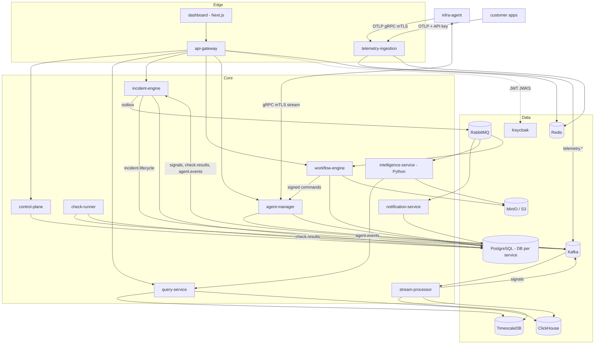

# InfraPilot — Architecture Overview

Status: **accepted** (baseline v1.0). Changes require a new ADR.

InfraPilot is a multi-tenant SaaS platform that monitors customer infrastructure, detects and
manages incidents, runs approved remediation workflows, and produces evidence-based
investigation reports.

## 1. System context

- **Users** (SRE/backend teams) use the Dashboard and the public REST API.
- **Host agents** run on customer machines and talk to InfraPilot over gRPC + mTLS.
- **Customer apps** send OTLP logs/traces/metrics to the ingestion endpoint with a project API key.
- **External targets** (APIs, TCP ports, TLS endpoints, DNS names) are probed by InfraPilot check workers.
- **Notification channels**: email (SMTP), Slack, Telegram, signed webhooks.
- **LLM provider**: pluggable (Anthropic / OpenAI-compatible) behind an interface.

## 2. Container diagram

## 3. Services (deployables)

| Service | Lang | Responsibility | Owns data | Sync API | Async |
|---|---|---|---|---|---|
| api-gateway | Go | Public REST/OpenAPI, JWT validation, rate limiting, request routing, BFF for dashboard. **No business logic.** | — (Redis counters) | REST in, gRPC out | — |
| control-plane | Go | Organizations, projects, members, roles, resources inventory, API keys, `CheckPermission` | `controlplane` DB | gRPC | produces `resource.state.v1` via outbox |
| check-runner | Go | Check definitions, distributed scheduling (lease-based), HTTP/TCP/TLS/DNS/ICMP probes with SSRF guard | `checks` DB | gRPC | produces `check.results.v1` |
| telemetry-ingestion | Go | OTLP gRPC/HTTP receiver, auth (API key / agent cert), validation, per-tenant quotas, backpressure | — (Redis quotas) | OTLP | produces `telemetry.{metrics,logs,spans}.v1` |
| stream-processor | Go | Consume telemetry & results, batch-write to TimescaleDB/ClickHouse, compute rollups, evaluate threshold rules, emit signals | writes TS + CH | — | consumes telemetry/results, produces `signals.v1` |
| query-service | Go | Read APIs over metrics/logs/traces (tenant-scoped, bounded queries, pagination) | read-only on TS + CH | gRPC | — |
| incident-engine | Go | Alert rules, signal correlation, dedup, incident state machine, timeline | `incidents` DB | gRPC | consumes signals/results/agent events; outbox → RabbitMQ + `incident.lifecycle.v1` |
| notification-service | Go | Channel config, routing, delivery with retries, signed webhooks | `notifications` DB | gRPC | consumes `notifications.deliver` |
| agent-manager | Go | Agent enrollment, internal CA, cert rotation, heartbeats, command channel | `agents` DB | gRPC (agent stream + internal) | produces `agent.events.v1` |
| workflow-engine | Go | Durable workflow state machines, approvals, policy evaluation, command signing, audit log | `workflows` DB | gRPC | consumes `workflows.step`; produces via outbox |
| intelligence-service | Python | Evidence collection, deterministic analyzers, LLM summarization, report generation | `intelligence` DB + S3 | REST (internal) | consumes `investigations.run` |
| infra-agent | Go | Host metrics, process/service status, log tailing, allow-listed actions | local state | gRPC client | — |
| dashboard | TS | Next.js App Router UI | — | calls gateway only | — |

## 4. Communication rules

- Public: REST + OpenAPI 3.0.3 at `/v1/...` (ADR-0020). Internal sync: gRPC with deadlines. Agents: bidirectional gRPC stream.
- Kafka = facts (events), RabbitMQ = commands (tasks). See ADR-0004.
- Events are Protobuf, wrapped in `infrapilot.events.v1.Envelope`. Breaking changes blocked by `buf breaking`.
- Internal traffic encrypted with TLS (cert-manager); Kubernetes NetworkPolicies default-deny.

## 5. Platform self-observability

InfraPilot's **own** telemetry is separate from customer data. Prometheus pulls service metrics from
`/metrics`. Traces and optional logs and metrics go through the OTel Collector to Tempo, Loki and
Prometheus. Grafana reads from those stores (ADR-0019).
Customer telemetry lives only in TimescaleDB/ClickHouse.

## 6. Initial SLOs (validated in M10)

| SLI | Target |
|---|---|
| Public API availability (non-5xx) | 99.9% / 30d |
| Public API p99 latency (reads) | < 300 ms |
| Ingestion acceptance (non-throttled) | 99.9% |
| Check result → incident opened | p95 < 30 s |
| Incident opened → first notification sent | p95 < 15 s |
| Telemetry queryable after ingest | p95 < 10 s |
| Sensitive actions audited | 100% |

## 7. Capacity design point (validated in M10 load tests)

1,000 orgs · 50k active checks at 30–60 s intervals · 5k agents · 20k telemetry events/s sustained,
50k/s burst · 30-day metrics retention (raw 7d + rollups) · 14-day logs/spans retention.
